# Claude Code Mod Gallery

Animated side panels for Claude Code that change when Claude is **idle** vs. **working**, plus two small prompt bands. I'm learning Claude Code mods by building things, and this is what came out so far.

> Every scene is a hand-written SVG animation (no image files). The previews below are the real pictures, captured with the idle state on the **left** and the working state on the **right** (an 8-second loop).

한국어 설명은 [아래](#한국어)에 있습니다.

## Requirements

- Claude Code **2.1.287 or later**. Mods are an early-access feature, so the API may change between versions.
- The animations show in the **desktop app**. In a terminal you get a still text picture instead.

## Install

This repository is a marketplace. Inside Claude Code:

```
/plugin marketplace add Gnosis333/mod_gallery
/plugin install night-train@mod-gallery
```

Or from a shell:

```bash
claude plugin marketplace add Gnosis333/mod_gallery
claude plugin install night-train@mod-gallery --scope user
```

Swap `night-train` for any mod below. Panels open **only when you run their slash command** (they don't open by themselves, to save CPU). After installing, run `/reload-plugins` or start a new session.

To try one mod without installing: `claude --plugin-dir mods/night-train`.

### Language

Labels (the status line, descriptions, replies) are **English by default**. Every mod also has a Korean (한국어) mode through its `language` option:

```bash
echo '{"language":"ko"}' | claude plugin configure night-train@mod-gallery --values-stdin
```

Then restart Claude Code. You can also run `/plugin configure night-train@mod-gallery` inside Claude Code, and `claude plugin configure night-train@mod-gallery` shows whether it is set. Use `en` to switch back.

## Mods

| Mod | Command | What it is |
|---|---|---|
| [`night-train`](#night-train) | `/train` | A night-train window |
| [`beach-day`](#beach-day) | `/beach` | A top-down beach |
| [`snow-cabin`](#snow-cabin) | `/snow` | A snowy cabin, day and night |
| [`deep-sub`](#deep-sub) | `/deep` | A deep-sea submersible |
| [`campfire`](#campfire) | `/fire` | A campfire to stare at |
| [`jungle-falls`](#jungle-falls) | `/falls` | A jungle waterfall with 24 kinds of animals |
| [`rain-window`](#rain-window) | `/rain` | A rainy window |
| [`moon-view`](#moon-view) | `/moon` | The universe seen from the Moon |
| [`tower-cut`](#tower-cut) | `/tower` | A building cross-section |
| [`desk-garden`](#desk-garden) | `/garden` | A desk plant and a workshop |
| [`reef-tank`](#reef-tank) | `/reef` | An aquarium |
| [`usage-band`](#usage-band) | automatic | Context, limits and cost on one line |
| [`haiku-warning`](#haiku-warning) | automatic | A warning while a Haiku model is selected |

---

## Panels

### night-train


A tall train window. At rest the train waits at `STATION` under lit lamp posts; when work starts the station slides away and hills, trees and poles stream past at different speeds. Now and then it runs through a long tunnel, and flocks of migrating birds cross the sky. The steam from the cup blows sideways, and when the turn ends the train rolls back into the station.

### beach-day

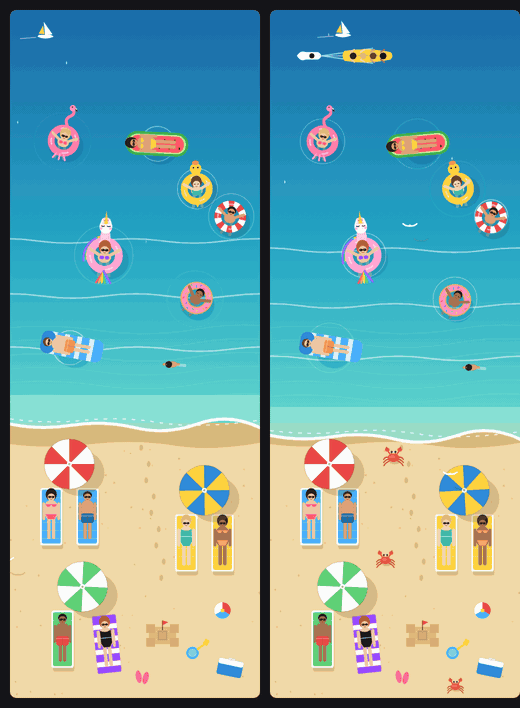

A beach seen from above. Gentle waves wash the shore, and people in sunglasses lie on sunbeds under parasols (bikinis, one-pieces and trunks). Out at sea swimmers float on all kinds of rings, **a pink unicorn among them**. While Claude works a jet ski and a banana boat go by, and crabs scuttle across the sand.

### snow-cabin

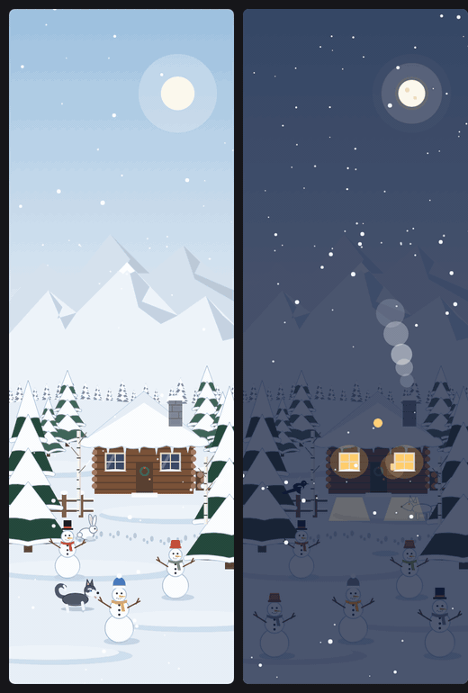

Snow falls softly over a white forest, snowy peaks and a log cabin. It's daytime at rest; while Claude works night falls, the windows glow, the chimney smokes, and **a snowman is built every 15 seconds**. A white rabbit, a white fox, a magpie and a husky come by.

### deep-sub

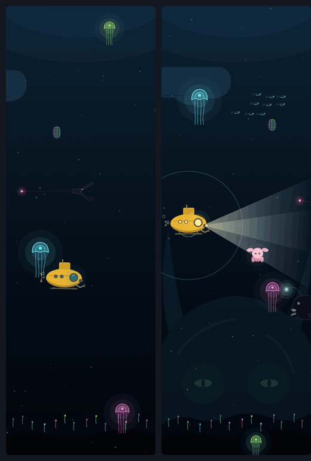

A yellow submersible drifts through the dark among glowing jellyfish, an anglerfish, lanternfish, a dumbo octopus and a gulper eel, while something vast and unknowable stirs faintly far below. While Claude works the searchlight comes on, sonar pings, and now and then the shadow of a giant squid sweeps past.

### campfire

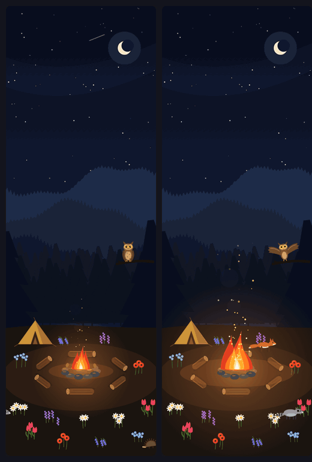

A campfire in a dense forest clearing under the stars. Flames lick, sparks crackle up, and a ring of logs and six kinds of flowers surround the fire. A fox, an owl (it swivels its head), a deer, a raccoon and a hedgehog drop by. The fire roars up while Claude works and dies back afterwards.

### jungle-falls

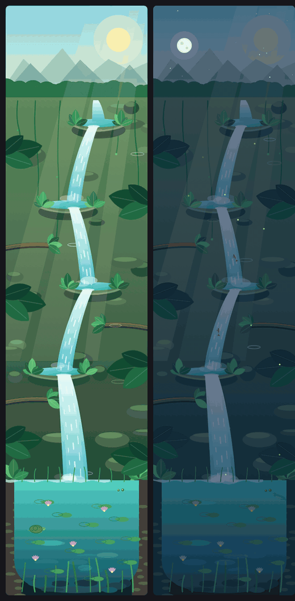

A terraced waterfall winds down into a lily pool. 24 kinds of animals visit at random (birds, monkeys, a jaguar, a crocodile, frogs, otters and more) and fish leap up the falls. It's day at rest and night while Claude works. This is the heaviest mod on CPU.

### rain-window

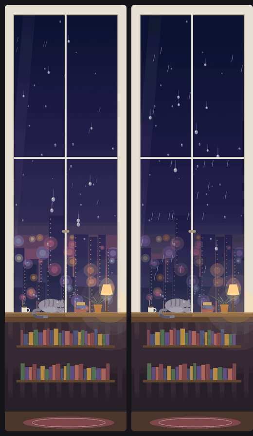

A rainy window: drops run down the glass and merge, city lights blur outside and a cat dozes on the sill. While Claude works a storm comes in, and when lightning strikes the cat opens its eyes and the desk lamp flickers. When the turn ends a rainbow comes out and fades away.

### moon-view

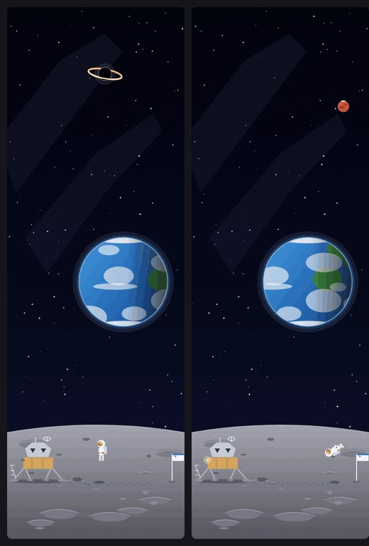

The Earth seen from the Moon. The lander's "eyes" flash and an astronaut bounces about (and tumbles around while Claude works). Stars, supernovae, a black hole, rockets, satellites, UFOs, planets and a few Star Wars-like ships pass at random.

### tower-cut

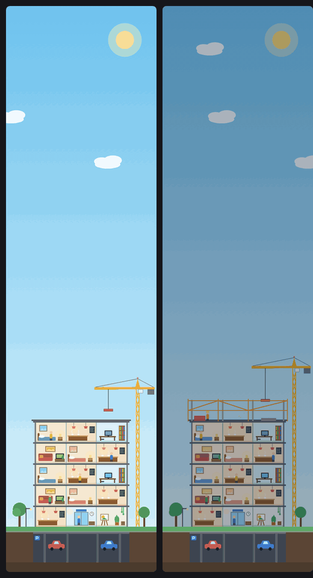

A building cross-section. **One floor goes up with every finished turn**, and at 20 floors the tower tops out with fireworks. A new session starts over. While Claude works the crane moves and raises the frame of the next floor.

### desk-garden

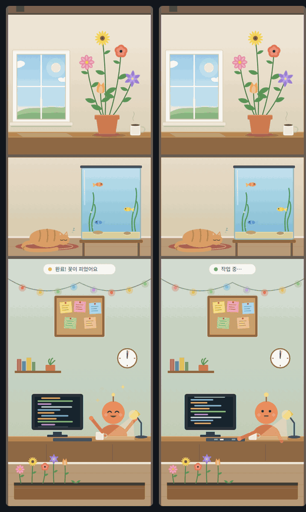

Three pictures stacked: a flowerpot by a window (one more flower blooms with every finished turn), a dozing cat by a fish tank, and a workshop where Claude's character works. While Claude works the character types at the keyboard.

### reef-tank

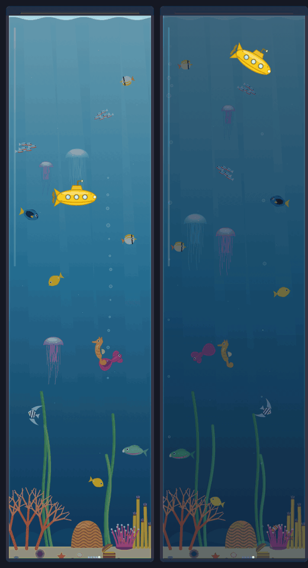

A tall aquarium with fish, a seahorse and jellyfish. While Claude works the lights dim and a yellow submarine dives; every finished turn adds a pearl to the treasure chest.

---

## Prompt bands

### usage-band

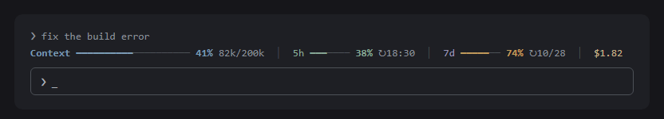

One line above the prompt: context window fill, the 5-hour and 7-day plan limits, and session cost. It turns amber at 70% and brick red at 85%, and each limit shows when it resets (`↻`). The image is an illustration of the look.

### haiku-warning

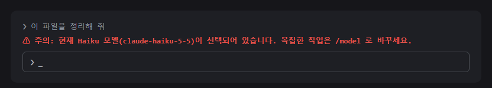

Shows a red warning above the prompt while a Haiku model is selected, as a reminder to switch before complex work. The image is an illustration of the look.

---

## Good to know

- **CPU**: moving pictures redraw constantly, so several panels open at once add up. Open only what you use. They don't affect model response speed, only drawing, heat and battery. `jungle-falls`, `snow-cabin` and `campfire` are larger pictures and relatively heavier.
- **Layout**: each mod lives in `mods/<name>/` with `.claude-plugin/plugin.json`, `hooks/register.tsx` (the behaviour), a test file and a state type. The part of `register.tsx` between `// ---scene-start` and `// ---scene-end` is what draws the picture.
- **Languages**: English (default) and Korean, chosen per mod with the `language` option (see [Language](#language)). The pictures themselves contain no text, except a few English words such as `STATION` and the speech bubble in `desk-garden`.

Built with [Claude Code](https://claude.com/claude-code).

## License

[MIT](LICENSE). Use, change and share freely.

---

## 한국어

Claude Code 옆에 띄워 두는 **그림 패널**과 입력창 위 **상태 띠**를 모았습니다. 패널은 Claude가 쉬고 있을 때와 일하고 있을 때 모습이 달라집니다. Claude Code의 모드를 공부하면서 이것저것 만들어 본 결과물입니다. 위 영어 부분의 그림(왼쪽 쉬는 중, 오른쪽 작업 중)이 그대로 해당합니다.

### 요구 사항과 설치

- Claude Code **2.1.287 이상**(모드는 얼리 액세스 기능이라 버전마다 API가 바뀔 수 있습니다)
- 그림 움직임은 **데스크톱 앱**에서 보입니다. 터미널에서는 글자 그림으로 나옵니다.

```
/plugin marketplace add Gnosis333/mod_gallery
/plugin install night-train@mod-gallery
```

`night-train` 자리에 위 표의 모드 이름을 넣으면 됩니다. 패널은 **슬래시 명령으로 열 때만** 열립니다(CPU를 아끼려고 자동으로 열지 않습니다). 설치 후 `/reload-plugins`를 입력하거나 새 세션을 여세요.

**한글 라벨로 보려면** 모드마다 `language` 옵션을 `ko`로 정하고 Claude Code를 다시 시작하세요(기본은 영어).

```bash
echo '{"language":"ko"}' | claude plugin configure night-train@mod-gallery --values-stdin
```

`/plugin configure night-train@mod-gallery`로도 정할 수 있습니다. 영어로 되돌리려면 `en`을 쓰세요.

### 모드 설명

- **night-train** (`/train`): 야간열차 창가. 쉴 때는 `STATION`에 정차해 가로등이 켜져 있고, 작업 중에는 산·나무·전신주가 서로 다른 속도로 흘러가며 가끔 긴 터널을 지납니다. 하늘에는 철새떼가 날아가고, 턴이 끝나면 다시 역으로 들어옵니다.
- **beach-day** (`/beach`): 위에서 내려다본 해변. 파라솔 아래 썬베드에 선글라스를 낀 사람들이 누워 있고, 바다에는 **핑크 유니콘 튜브**를 비롯한 여러 튜브가 떠 있습니다. 작업 중에는 제트스키, 바나나보트, 꽃게가 나옵니다.
- **snow-cabin** (`/snow`): 눈이 소복소복 내리는 흰 숲과 설산, 통나무 오두막. 쉴 때는 낮, 작업 중에는 밤이 되어 창에 불이 켜지고 **눈사람이 15초마다 하나씩** 생깁니다. 흰 토끼, 흰 여우, 까치, 허스키가 찾아옵니다.
- **deep-sub** (`/deep`): 어둠 속 노란 잠수정과 야광 해파리, 아귀, 덤보 문어, 풍선장어, 그리고 저 아래 희미하게 움직이는 정체불명의 거대한 것. 작업 중에는 탐조등과 소나가 켜지고 가끔 거대 오징어 그림자가 스칩니다.
- **campfire** (`/fire`): 별이 가득한 밤 숲속 공터의 모닥불. 불꽃과 불티, 통나무 원, 꽃 여섯 종류, 여우·올빼미(머리를 돌립니다)·사슴·너구리·고슴도치. 작업 중에는 불이 커지고 끝나면 잦아듭니다.
- **jungle-falls** (`/falls`): 계단식 폭포와 연꽃 연못, 동물 24종이 무작위로 방문. 쉴 때는 낮, 작업 중에는 밤. CPU를 가장 많이 씁니다.
- **rain-window** (`/rain`): 비 오는 창가. 작업 중에는 폭풍, 번개가 치면 고양이가 눈을 뜨고 스탠드가 깜빡이며, 끝나면 무지개가 뜹니다.
- **moon-view** (`/moon`): 달에서 본 지구. 통통 뛰는 우주인(작업 중에는 빙빙 돕니다), 무작위로 지나가는 우주 물체와 스타워즈풍 우주선.
- **tower-cut** (`/tower`): 빌딩 단면. 턴이 끝날 때마다 한 층씩 올라가고 20층이면 준공 불꽃놀이.
- **desk-garden** (`/garden`): 창가 화분(턴마다 꽃이 핍니다), 졸고 있는 고양이와 수조, Claude가 일하는 작업실.
- **reef-tank** (`/reef`): 수족관. 작업 중에는 조명이 어두워지고 노란 잠수함이 내려오며, 턴이 끝날 때마다 진주가 쌓입니다.
- **usage-band**: 입력창 위 한 줄로 컨텍스트, 5시간·7일 한도(초기화 시각 `↻` 포함), 비용을 보여줍니다.
- **haiku-warning**: Haiku 모델이 선택돼 있으면 입력창 위에 빨간 경고를 띄웁니다.

### 알아 둘 것

- 움직이는 그림은 화면을 계속 그리므로 패널을 여러 개 동시에 열면 CPU 부담이 합쳐집니다. 쓰는 것만 여세요. 모델 응답 속도와는 무관하고, 화면 그리기와 발열·배터리에만 영향이 있습니다. `jungle-falls`, `snow-cabin`, `campfire`는 그림이 커서 상대적으로 무겁습니다.
- 글자(상태 줄, 그림 설명, 열기 답장)는 기본이 영어이고, `language` 옵션을 `ko`로 하면 한글입니다. 그림 속 글자는 `STATION`과 `desk-garden`의 말풍선 정도입니다(말풍선은 옵션을 따릅니다).
- 라이선스는 [MIT](LICENSE)입니다. 누구나 자유롭게 쓰고, 고치고, 다시 배포해도 됩니다.

모두 [Claude Code](https://claude.com/claude-code)로 만들었습니다.
