# Claude Code Mod Gallery

Claude Code 옆에 띄워 두는 **그림 패널**과 입력창 위 **상태 띠**를 모았습니다. 패널은 Claude가 쉬고 있을 때와 일하고 있을 때 모습이 달라집니다.
A small collection of mods for Claude Code: animated side panels that change when Claude is idle vs. working, and two prompt bands.

> 모든 장면은 코드로 그린 SVG 애니메이션입니다(이미지 파일 없음). 아래 그림은 각 모드를 실제로 그려서 **왼쪽 쉬는 중 / 오른쪽 작업 중**으로 캡처한 것입니다.

## 요구 사항

- Claude Code **2.1.287 이상** (모드는 얼리 액세스 기능이라 버전마다 API가 바뀔 수 있습니다)
- 그림 움직임은 **데스크톱 앱**에서 보입니다. 터미널에서는 글자 그림으로 나옵니다.

## 설치

이 저장소는 마켓플레이스입니다. Claude Code 안에서:

```
/plugin marketplace add Gnosis333/mod_gallery
/plugin install night-train@mod-gallery
```

또는 터미널에서:

```bash
claude plugin marketplace add Gnosis333/mod_gallery
claude plugin install night-train@mod-gallery --scope user
```

`night-train` 자리에 아래 표의 모드 이름을 넣으면 됩니다. 패널 모드는 **슬래시 명령으로 열 때만** 열립니다(CPU를 아끼려고 자동으로 열지 않습니다). 설치 직후에는 `/reload-plugins`를 입력하거나 새 세션을 여세요.

## 모드 목록

| 모드 | 여는 법 | 한 줄 설명 |
|---|---|---|
| [`night-train`](#night-train) | `/train` | 야간열차 창가 |
| [`beach-day`](#beach-day) | `/beach` | 위에서 내려다본 해변 |
| [`snow-cabin`](#snow-cabin) | `/snow` | 낮밤이 바뀌는 눈 오는 오두막 |
| [`deep-sub`](#deep-sub) | `/deep` | 심해 잠수정 |
| [`campfire`](#campfire) | `/fire` | 불멍용 모닥불 |
| [`jungle-falls`](#jungle-falls) | `/falls` | 정글 폭포와 동물 24종 |
| [`rain-window`](#rain-window) | `/rain` | 비 오는 창가 |
| [`moon-view`](#moon-view) | `/moon` | 달에서 본 우주 |
| [`tower-cut`](#tower-cut) | `/tower` | 빌딩 단면 |
| [`desk-garden`](#desk-garden) | `/garden` | 책상 위 화분과 작업실 |
| [`reef-tank`](#reef-tank) | `/reef` | 수족관 |
| [`usage-band`](#usage-band) | 자동 | 컨텍스트·한도·비용 한 줄 |
| [`haiku-warning`](#haiku-warning) | 자동 | Haiku 모델 경고 |

---

## 패널

### night-train

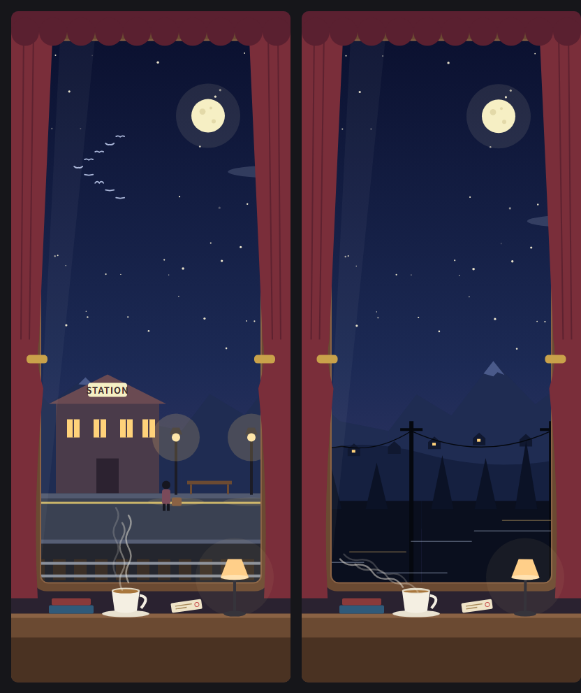

상하로 긴 열차 창가입니다. 쉴 때는 `STATION`에 정차해 가로등이 켜져 있고, 작업이 시작되면 역이 빠져나가며 산·나무·전신주가 서로 다른 속도로 흘러갑니다. 가끔 긴 터널을 지나고, 하늘에는 철새떼가 날아갑니다. 찻잔의 김이 바람에 날리고, 턴이 끝나면 다시 역으로 들어옵니다.

### beach-day

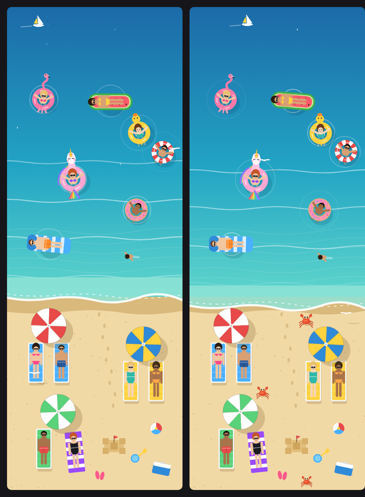

위에서 내려다본 해변입니다. 잔잔한 파도가 밀려오고, 파라솔 아래 썬베드에 선글라스를 낀 사람들이 누워 있습니다(비키니·원피스·반바지). 바다에는 **핑크 유니콘 튜브**를 비롯해 여러 튜브가 떠 있습니다. 작업 중에는 제트스키와 바나나보트가 지나가고 꽃게가 모래 위를 옆으로 걷습니다.

### snow-cabin

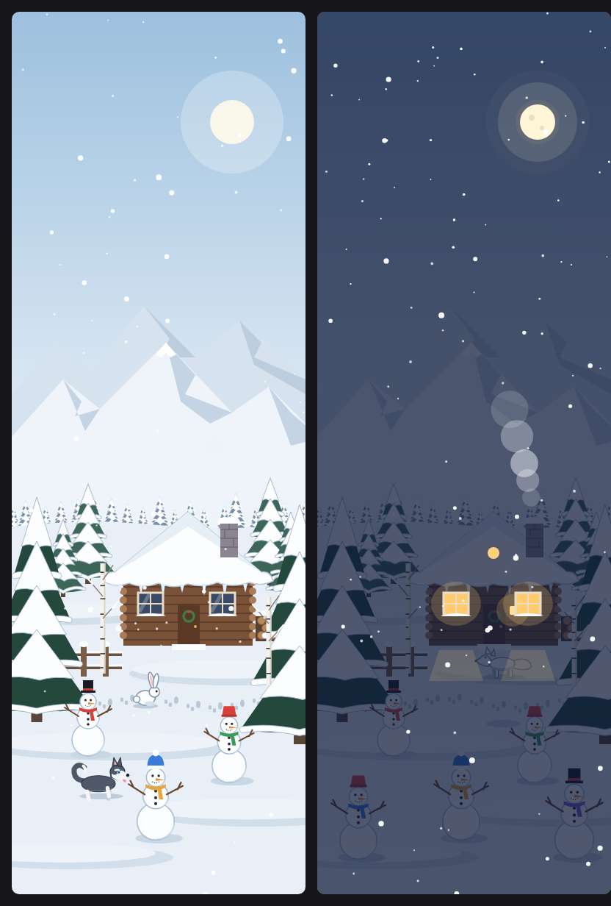

눈이 소복소복 내리는 흰 숲과 설산, 통나무 오두막입니다. 쉴 때는 낮이고, 작업 중에는 밤이 되어 창에 불이 켜지고 굴뚝 연기가 짙어지며 **눈사람이 15초마다 하나씩** 생깁니다. 흰 토끼, 흰 여우, 까치, 허스키가 찾아옵니다.

### deep-sub

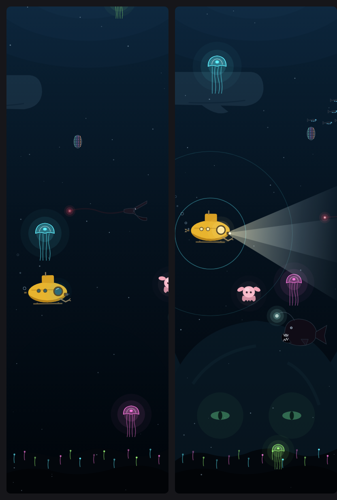

어둠 속을 천천히 떠도는 노란 잠수정과 발광 생물들입니다. 야광 해파리, 아귀, 샛비늘치 떼, 덤보 문어, 풍선장어가 지나가고, 저 아래에는 정체를 알 수 없는 거대한 것이 희미하게 떠올랐다 사라집니다. 작업 중에는 탐조등이 켜지고 소나가 울리며, 가끔 거대 오징어의 그림자가 스칩니다.

### campfire

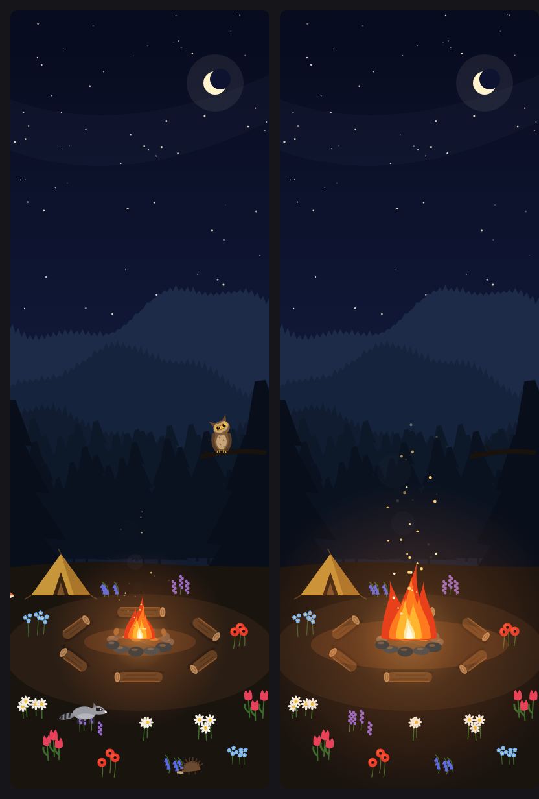

별이 가득한 밤, 빽빽한 숲속 공터의 모닥불입니다. 불꽃이 일렁이고 불티가 탁탁 튀어 오르며, 둘레에 통나무와 여섯 종류의 꽃이 있습니다. 여우, 올빼미(머리를 휙 돌립니다), 사슴, 너구리, 고슴도치가 찾아옵니다. 작업 중에는 불이 커지고, 끝나면 잦아듭니다.

### jungle-falls

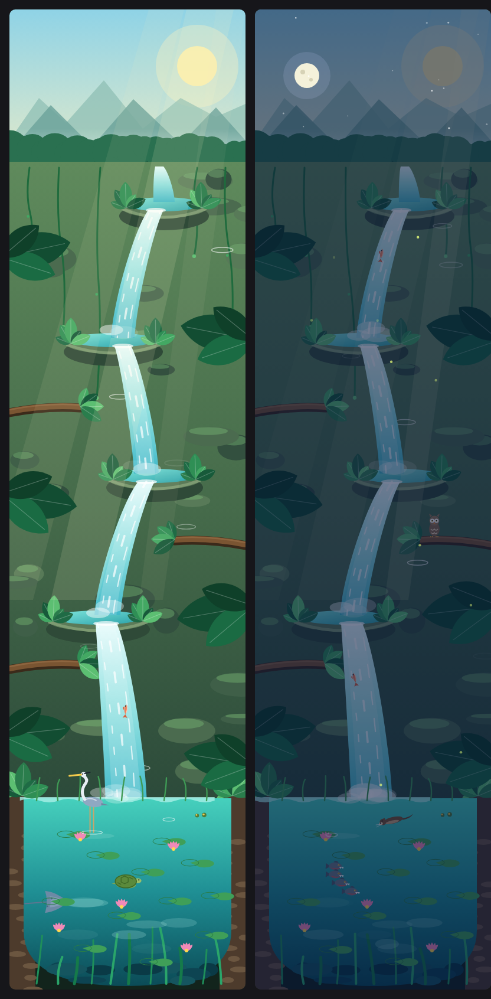

굽이쳐 내려오는 계단식 폭포와 연꽃 연못입니다. 동물 24종이 무작위로 찾아오고(새, 원숭이, 재규어, 악어, 개구리, 수달 등), 폭포를 거슬러 오르는 물고기가 팔딱입니다. 쉴 때는 낮, 작업 중에는 밤입니다. 그림이 커서 이 모드가 CPU를 가장 많이 씁니다.

### rain-window

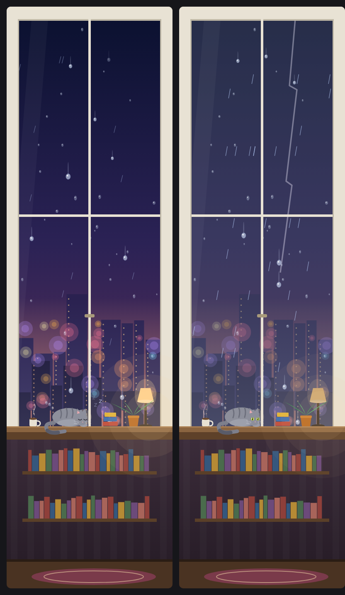

비 오는 창가입니다. 빗방울이 유리를 타고 내려가며 합쳐지고, 도시 불빛이 번지며, 고양이가 창턱에서 졸고 있습니다. 작업 중에는 폭풍이 오고 번개가 치면 고양이가 눈을 뜨고 스탠드 불빛이 깜빡입니다. 끝나면 무지개가 떴다가 사라집니다.

### moon-view

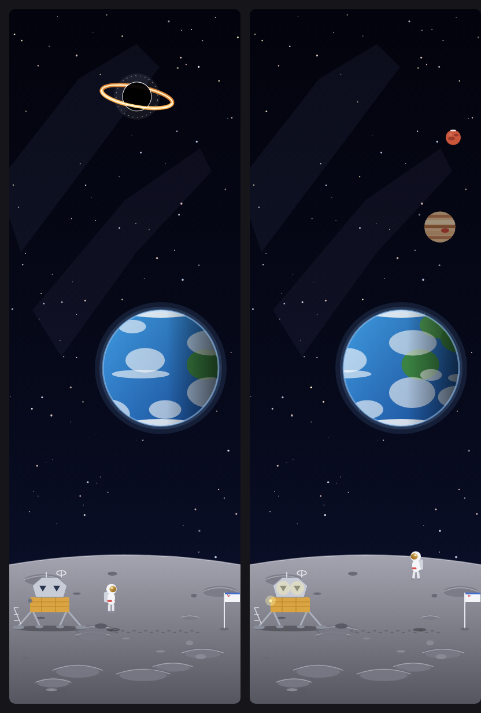

달 표면에서 본 지구입니다. 착륙선의 "눈"이 번쩍이고, 우주인이 통통 뛰어다닙니다(작업 중에는 중심을 못 잡고 빙빙 돕니다). 별, 초신성, 블랙홀, 로켓, 위성, UFO, 행성, 그리고 스타워즈풍 우주선이 무작위로 지나갑니다.

### tower-cut

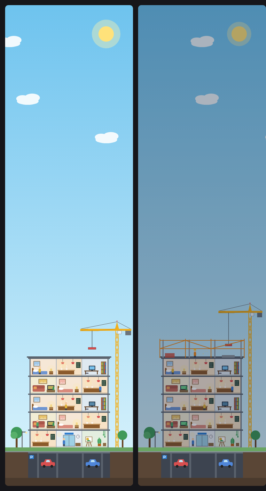

빌딩 단면입니다. **턴이 끝날 때마다 한 층**씩 올라가고, 20층이 되면 준공 불꽃놀이를 합니다. 세션이 끝나면 처음부터 다시 짓습니다. 작업 중에는 타워크레인이 움직이며 다음 층의 뼈대를 세웁니다.

### desk-garden

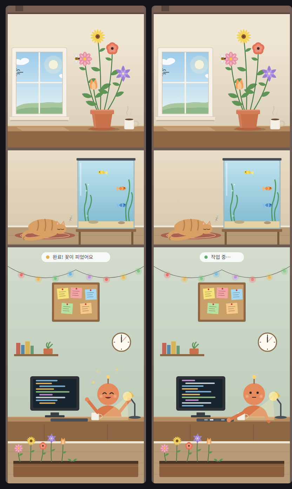

창가의 화분(턴이 끝날 때마다 꽃이 핍니다), 졸고 있는 고양이와 수조, 그리고 Claude가 일하는 작업실이 위아래로 쌓인 패널입니다. 작업 중에는 작업실의 Claude가 키보드를 칩니다.

### reef-tank

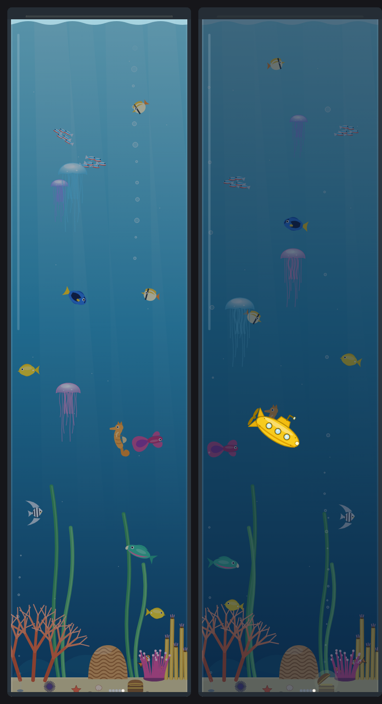

물고기, 해마, 해파리가 있는 키 큰 수족관입니다. 작업 중에는 조명이 어두워지고 노란 잠수함이 내려오며, 턴이 끝날 때마다 보물상자에 진주가 하나씩 쌓입니다.

---

## 상태 띠 (입력창 위)

### usage-band


입력창 위 한 줄에 컨텍스트 사용량, 5시간·7일 한도, 세션 비용을 보여줍니다. 70%부터 호박색, 85%부터 벽돌색으로 바뀌고, 한도마다 **초기화 시각(↻)** 이 붙습니다. 이미지는 모습을 보여 주는 예시입니다.

### haiku-warning


Haiku 모델이 선택돼 있으면 입력창 위에 빨간 경고를 띄워 복잡한 작업 전에 모델을 바꾸도록 알려줍니다. 이미지는 모습을 보여 주는 예시입니다.

---

## 알아 둘 것

- **CPU**: 움직이는 그림은 화면을 계속 그리므로 패널을 여러 개 동시에 열면 부담이 합쳐집니다. 쓰는 것만 여세요. 모델 응답 속도와는 무관하고, 영향은 화면 그리기와 발열·배터리뿐입니다. `jungle-falls`, `snow-cabin`, `campfire`는 그림이 커서 상대적으로 무겁습니다.
- **구조**: 각 모드는 `mods/<이름>/` 아래에 `.claude-plugin/plugin.json`, `hooks/register.tsx`(실제 동작), 테스트 파일, 상태 타입으로 이뤄져 있습니다. `register.tsx`의 `// ---scene-start` ~ `// ---scene-end` 사이가 그림을 만드는 부분입니다.
- **직접 써 보기**: 한 모드만 시험하려면 `claude --plugin-dir mods/night-train`처럼 폴더를 지정해 시작할 수도 있습니다.

모두 [Claude Code](https://claude.com/claude-code)로 만들었습니다.
