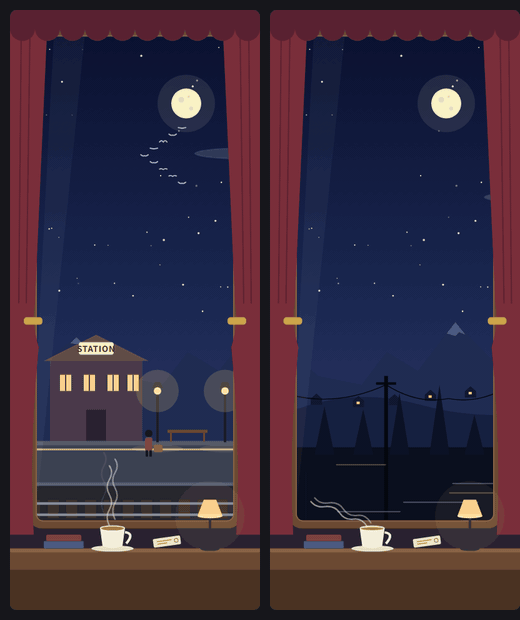

# night-train



A tall night-train window pane. At rest the train waits at a lamp-lit station. While Claude works it runs through the night with hills, trees and poles streaming past, sometimes through a long tunnel, with migrating birds crossing the sky. When the turn ends it pulls back into the station.

This is a mod for Claude Code: a decorative panel drawn as a hand-written SVG animation. It changes between an idle look and a working look so you have something calm to watch while Claude runs a long task.

## Install

```bash
claude plugin marketplace add Gnosis333/mod_gallery
claude plugin install night-train@mod-gallery --scope user
```

Then run `/reload-plugins` or start a new session. The panel opens only when you run `/train`, so it costs nothing until you ask for it.

## Language

Labels are English by default. For Korean, run `echo '{"language":"ko"}' | claude plugin configure night-train@mod-gallery --values-stdin` and restart. Use `en` to switch back.

## What it does and does not do

It only draws an animated SVG pane and one slash command (`/train`), and it reads Claude's idle or working state to switch the scene. It makes no network requests, reads or writes no files, runs no processes, and sends no data anywhere.

Part of [mod_gallery](https://github.com/Gnosis333/mod_gallery). MIT licensed.
